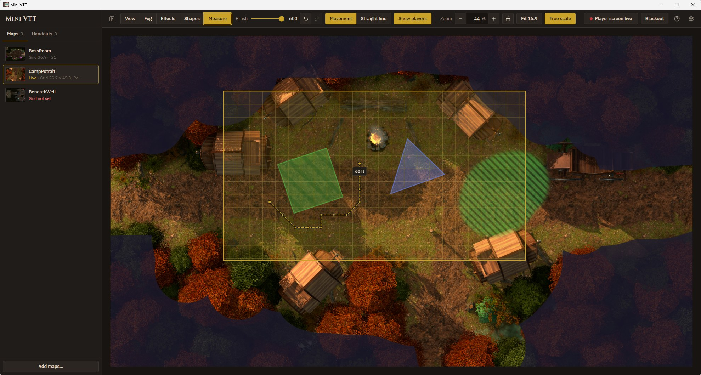
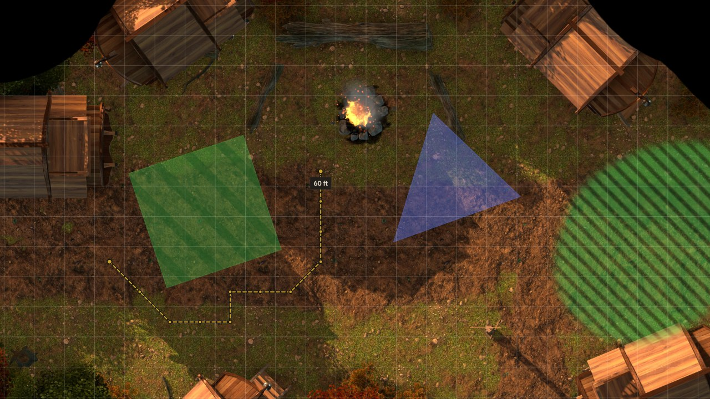

# Mini VTT

Welcome to my hobby project Mini VTT that I created because I wanted a basic, low resource VTT that me and my friends use when we play.
We only play locally with mini figures so we do not need tokens, online capabilities, initiative tracker etc.
First of all I have used AI to generated code for this project. But no AI art, music or other artistic assets are AI generated nor will there be any. Yes I drew the icon myself. In Paint.

I am an senior engineer but I program VHDL mostly. Or System Verilog. Even though a FPGA based VTT sound interesting it would be far from practical.
So while I am quite experienced in designing robust firmware I lack the skills to make something like this within any reasonable time without AI.

Also this is based upon Lazy DM Companion I found on github https://github.com/felipeabviana/lazy_dm_companion if you want an even more basic great little software.
Not much code is still the same and I have added a lot. But still thanks to Felipe for giving me something to start from.

So this is a VTT I wanted to make because my group play local only with a weak laptop and an OLED TV laying flat connected by HDMI. No tokens. No online.
I wanted just maps and fog of war basically. Focus of the software is low system resource usage. Features have been added but I am trying to keep it simple.

I will write more of the text myself when it is more feature complete but from here the rest of the text is mostly AI generated that gets updated as features change or gets added.

You run Mini VTT on your laptop. The **DM window** stays on your screen, where you pick maps, paint fog of war and decide what the players see. The **player screen** goes on a TV, a monitor laid flat on the table, or a projector, and shows only the part of the map you've framed, with unrevealed areas in solid black.

It's built to stay out of the way on modest hardware: no accounts, no server, no internet connection, and nothing running in the background while you're not touching it.

| DM window                                                                                                                                                                         | Player screen                                                                                                                                                            |
| --------------------------------------------------------------------------------------------------------------------------------------------------------------------------------- | ------------------------------------------------------------------------------------------------------------------------------------------------------------------------ |
|  |  |

## Features

- **Fog of war.** Select the Fog tool and paint: the left mouse button reveals, the right button covers. Draw around an area with the lasso, or drag a rectangle, to reveal it all at once, or click to reveal a circle sized in feet, such as a torch's light (the wheel sizes it in 5 ft steps). Undo and redo any change, or reveal or cover the whole map at once. The DM sees fog as an indigo tint; players see solid black.
- **Fog rooms.** Mark out the rooms of a dungeon before the session, then reveal each one with a click as the party walks in. Rooms can be named, moved, resized and copied (Ctrl+C over one, then Ctrl+V where the copy should go), and each shows whether it is hidden, partly open or open. Only you see them.
- **Painted effects.** The Effects tool paints fire, poison or magic onto the map with soft edges, for burning terrain, poison clouds or spell areas. Right-click erases, **Clear** removes them all. Effects and circles sit under the fog, so they never give away unexplored areas, and poison is hatched so it stays distinct from fire for colour-blind players. A map that never uses effects costs nothing extra, and **Settings → Show effect and spell tools** hides them, and spell areas, entirely.
- **Spell areas.** In the Spells tool (S), place a circle (Spirit Guardians, Fireball), square (cube), cone or line/wall, sized in feet; another one added lands beside it rather than on top. Drag its dot to move it, there or in the View tool (hold Ctrl to snap it to the grid), turn the mouse wheel over it to resize it in 5 ft steps (a line's width), or type the size. Cones and lines have a handle at their tip: drag it to aim and set the length (hold Ctrl to turn in 45° steps). A square's handle sits on one edge: drag it to turn the square (it settles square to the grid near a right angle) and, towards or away from the centre, to set its size. The squares each area covers are outlined, for players too, so it is plain which minis are caught: a circle (a sphere or an emanation such as Spirit Guardians) covers the squares within its radius counted as movement is, with diagonals 5, 10, 5 ft (or every square the same, following **Settings → Movement**); a square, cone or line covers a square when it covers at least half of it. **Settings → Show squares spell areas cover** turns them off. The DM sees the size; players only see the area. Measure the map's grid once (**Settings → Measure map grid…**: click two corners of a square) so feet match the map. A map whose file or folder name gives its size, such as `forest_32x32.jpg` or `140ppi`, gets its grid as it is added; the map library shows which maps have one.
- **Measuring distances.** The Measure tool (M) shows the distance in feet as you drag across the map, or click point by point to measure a path round corners (double-click or Enter finishes it, right-click takes back a point, Esc or Backspace clears it). **Movement** counts squares, with diagonals 5, 10, 5 ft by default (**Settings → Movement: every square** counts them all the same); **Straight line** measures as the crow flies (hold Ctrl to snap its ends to square centres). Only you see the ruler until you turn on **Show players**.
- **Player view framing.** A frame on the DM window (gold, or another colour picked in **Player screen setup**) shows exactly what the player screen shows. Drag it to pan (hold Ctrl to move it a whole square at a time, lined up with the map's grid) and scroll over it to zoom. While the zoom is locked, a padlock shows in its corner.
- **True-scale grid.** Enter the player screen's diagonal and your grid size, and the frame shows a grid that matches the physical screen, so 1-inch minis line up with the map. **True scale** (next to **Fill screen**) zooms the player view so the map's own squares come out at that size. On a map without a grid, it has you measure the grid first. **Settings → Show grid on player screen** draws the map's measured grid for the players too.
- **Fill screen.** Zooms the player view so the map fills the player screen with no black edges, and keeps the frame on the map. A player window that is not full screen first takes the shape of the screen it is on (16:9, 16:10, 4:3 or ultrawide).
- **Blackout.** One key hides everything on the player screen while you set up the next scene.
- **Kill screen.** Ctrl+K fades the player screen to black and shows a random line in red, such as “FINISH IT!”, for the moment an enemy falls.
- **Map library.** Maps, along with each map's fog, rooms, effects, zoom, framing, rotation and mirroring, are saved automatically and restored when you switch maps or restart.
- **Animated maps.** WebM videos work as maps alongside PNG, JPEG, GIF, WebP and BMP images. If a video is larger than your computer can decode in hardware, Mini VTT suggests a size that plays smoothly.
- **Handouts.** Show a letter, portrait or clue fullscreen on the player screen, then hide it to return to the map.
- **Clean player screen.** Its few buttons and the mouse cursor fade out when the mouse is idle, so players only see the map.

## Getting started

### Download

Prebuilt Windows, macOS and Linux builds are published on the [Releases](https://github.com/Paertan85/mini_vtt/releases) page when available. The builds are not code-signed, so Windows SmartScreen and macOS Gatekeeper will warn the first time you open them. On a Mac, right-click the app and choose **Open**; if macOS says the app is damaged, run `xattr -cr "/Applications/Mini VTT.app"` in Terminal once.

The macOS build needs macOS 13 (Ventura) or later. It is tested automatically but hasn't been tried on a real Mac yet; reports are welcome.

On Linux, including a Steam Deck in desktop mode, download the `.AppImage`, make it executable (right-click → Properties → Permissions, or `chmod +x`) and open it. It runs from your home folder, so SteamOS updates don't remove it. Touch works on the Deck but isn't comfortable to use yet, so connect a keyboard and mouse; they work as on a PC.

### Build from source

You'll need [Node.js](https://nodejs.org/) 20 or newer.

```bash
git clone https://github.com/Paertan85/mini_vtt.git
cd mini_vtt
npm install
npm run dev
```

To package an installer:

```bash
npm run dist:win   # Windows installer + portable .exe, written to release/
npm run dist:mac   # macOS .dmg (arm64 and x64); run this on a Mac
npm run dist:linux # Linux AppImage (x64); run this on Linux
```

Without a Mac or Linux machine, run the **CI** workflow by hand on GitHub (Actions → CI → Run workflow): it tests the app on Windows, macOS and Linux and attaches the installers for all three to the run. Pushing a version tag does the same and also drafts a GitHub release with them; see [Releasing](CONTRIBUTING.md#releasing).

## Running a session

A welcome screen on first start sums this up; tick **Don’t show on start-up** to skip it, and open it again with the **?** button next to Settings.

1. Click **Add maps…** in the library, or drop image or WebM files onto it. New maps start without fog: cover one with **Whole map → Cover entire map**, or tick **Settings → Cover new maps in fog** to have new maps start fully fogged.
2. Click **Open player screen**. With a second screen connected, such as the table TV, it opens full screen there (on the largest one, if there are several, or on the one it was last on). On a single screen it opens in a window: drag it where you want it, and press F11, double-click it, or use the button in its corner, to go fullscreen.
3. Optionally, open **Settings → Player screen setup…** and enter the screen's diagonal and your grid size to get a true-scale grid in the frame.
4. With the **View** tool, drag the frame to choose what the players see, and scroll over it to zoom.
5. Switch to the **Fog** tool and paint to reveal areas as the party explores.

Everything is saved as you go. Double-click another map in the library to switch; it comes back exactly as you left it. Rotation and mirroring are in each map's **⋯** menu.

**Rotation of new maps and handouts.** A screen lying on the table is usually played lengthwise, with the DM at one end. So maps and handouts that are taller than wide are turned left as you add them, to lie along the screen; square and wide ones are left as they are. To turn them right instead, or not at all, open **Settings → Player screen setup…**. You can still rotate any map or handout afterwards from its **⋯** menu.

### Controls

On a Mac, use Cmd for Ctrl and Option for Alt.

| Action                                       | How                                                                                                                                                                                                              |
| -------------------------------------------- | ---------------------------------------------------------------------------------------------------------------------------------------------------------------------------------------------------------------- |
| View / Fog / Effects / Spells / Measure tool | V / F / E / S / M                                                                                                                                                                                                |
| Reveal / cover fog                           | Fog tool, then drag with the left / right mouse button                                                                                                                                                           |
| Reveal / cover a whole room                  | Fog tool, **Lasso** (or L), then draw around it with the left / right mouse button; the inside is filled on release                                                                                              |
| Reveal / cover a rectangle                   | Fog tool, **Rectangle** (or R), then drag with the left / right mouse button (Ctrl: snap to the grid)                                                                                                            |
| Reveal / cover a circle sized in feet        | Fog tool, **Circle** (or C), then click with the left / right mouse button; the mouse wheel sizes it in 5 ft steps, or drag out from its centre (Ctrl: centred on a square). Needs the map's grid                |
| Prepare rooms to reveal later                | Fog tool, **Rooms**, then drag around each room (Ctrl: snap to the grid). Drag a room to move it, or an edge or corner to resize it, and type its name in its bar                                                |
| Copy a prepared room                         | Fog tool, **Rooms**, then Ctrl+C with the mouse pointer over the room; Ctrl+V pastes a copy at the pointer (on the grid if the room was)                                                                         |
| Reveal / cover a prepared room               | Fog tool, **Rooms**, then click inside the room / right-click inside it, or use the eye on its bar. The bar says whether the room is hidden, partly open or open                                                 |
| Paint / erase effects                        | Effects tool, pick a colour, then drag with the left / right mouse button                                                                                                                                        |
| Add a spell area                             | Spells tool, then **Circle**, **Square**, **Cone** or **Line**; another one lands beside it, not on top                                                                                                          |
| Move an area                                 | Spells or View tool: drag its dot (Ctrl: snap to the grid), or arrow keys (one square; Shift: 1 ft)                                                                                                              |
| Resize an area                               | Mouse wheel over it (5 ft steps; a line's width), or type the size in its toolbar                                                                                                                                |
| Aim a cone or line                           | Drag the handle at its tip; the length follows in 5 ft steps (Ctrl: turn in 45° steps)                                                                                                                           |
| Turn or size a square                        | Drag the handle on its edge; the side follows in 5 ft steps                                                                                                                                                      |
| Measure a distance                           | Measure tool, then drag, or click each point of a path and double-click to finish; the distance shows in feet. **Movement** or **Straight line** in the toolbar, **Show players** to put it on the player screen |
| Duplicate / delete an area                   | Ctrl+D / Del, or the buttons in its toolbar                                                                                                                                                                      |
| Paint fog with any tool                      | Hold Shift and use either mouse button                                                                                                                                                                           |
| Brush size                                   | Mouse wheel in the Fog or Effects tool (or while holding Shift), or [ and ]                                                                                                                                      |
| Undo / redo                                  | Ctrl+Z / Ctrl+Y or Ctrl+Shift+Z (effects in the Effects tool, otherwise fog)                                                                                                                                     |
| Zoom your own view                           | Ctrl + mouse wheel, or pinch, in any tool; Ctrl+= / Ctrl+− / Ctrl+0 fits (players are unaffected)                                                                                                                |
| Pan your zoomed view                         | Drag with the middle mouse button                                                                                                                                                                                |
| Move the player view while painting          | Alt + drag the frame, in any tool                                                                                                                                                                                |
| Keep the player view on the grid             | Ctrl + drag the frame, on a map with a grid: it moves a whole square at a time, with the squares lined up on the top and left edges of the player screen                                                         |
| Zoom the player view                         | + and − keys, the toolbar buttons, mouse wheel over the frame in the View tool, or Alt + mouse wheel in 1% steps (any tool)                                                                                      |
| Keep the player view zoom from changing      | The lock button next to the zoom, or Space: the mouse wheel, the + and − keys, the zoom buttons and **True scale** leave it alone until you unlock it                                                            |
| Zoom so the map's squares fit your minis     | **True scale**, after Player screen setup, with the player screen open (a map without a grid gets it measured first)                                                                                             |
| Blackout the player screen                   | B                                                                                                                                                                                                                |
| Show the kill screen after a kill            | Ctrl+K: red words on black, turned like portrait handouts; Ctrl+K again hides it                                                                                                                                 |
| Load a map / show a handout                  | Double-click it in the library (a selected map: Enter)                                                                                                                                                           |
| Add maps                                     | Ctrl+O, **Add maps…**, or drop files on the library                                                                                                                                                              |
| Hide / show maps and handouts                | The panel button at the left of the toolbar, or Ctrl+B (more room for the map)                                                                                                                                   |
| Hide / show everything but the map           | Ctrl+Shift+B hides the toolbar and the panel, for small screens such as the Steam Deck's; Ctrl+Shift+B or Ctrl+B brings them back                                                                                |
| Rename, rotate, mirror or remove             | The ⋯ menu on the map or handout                                                                                                                                                                                 |
| Move or zoom a handout                       | On the player screen: drag it or use the arrow keys (Shift: bigger steps); the mouse wheel or a pinch zooms at the pointer; Esc closes                                                                           |
| Player screen fullscreen                     | F11, a double-click, or the corner button                                                                                                                                                                        |
| Show all shortcuts                           | ?                                                                                                                                                                                                                |

All shortcuts are also listed under **Menu (☰) → Keyboard shortcuts…**.

### Where your library is stored

Maps, fog masks and settings live in a `library` folder inside the app's user-data directory (typically `%APPDATA%\mini-vtt\library` on Windows, `~/Library/Application Support/mini-vtt/library` on macOS, and `~/.config/mini-vtt/library` on Linux). **Menu (☰) → Open library folder** opens it. Imported files are copied there, so moving or deleting the originals doesn't affect the library.

### Moving your library to another computer

**Menu (☰) → Export project…** saves the whole library (every map and handout with its fog, effects, zoom, framing, rotation, mirroring and order, plus the player screen setup) as a single `.minivtt` file. Copy that file to the other computer and choose **Menu (☰) → Import project…** there. Importing adds the project's maps and handouts to whatever is already in the library and never replaces anything; the player screen setup is taken over only when the library is still empty.

A `.minivtt` file is an ordinary ZIP archive, so any unzip tool can open it (rename it to `.zip` first). [docs/project-format.md](docs/project-format.md) explains how to make one yourself, by hand or from another program, and the rules that keep files readable across versions and forks. Mini VTT 1.1 and 1.2 can't open these files, but files from those versions still import.

## Known limitations

Corner cases Mini VTT doesn't handle, so they don't come as a surprise.

**Grid from the file name.** When a name gives no grid that fits, the map is added without one, and you measure it with **Settings → Measure map grid…**.

- A size may be given across × down or down × across; whichever fits the image is used.
- The squares across and down must give square cells: the width and the height may differ by at most 2%. A 2250 × 4500 map named `22x45` is 2.3% off (102 px across, 100 px down), so it gets no grid.
- A pair that fits the image neither way round is passed over, as is one that is the image's own size (`4200x4760` on a 4200 × 4760 image) or is marked `px`.
- Only the file name and the three folders above it are read; a size further up is not.
- When a name holds several sizes that fit, the last one wins, and a size in the file name wins over one in a folder.
- A squares count wins over a PPI value. `DPI` is not read, since it usually means print resolution, not pixels per square.
- A square must come out between 8 and 1000 pixels.

**File formats.**

- Maps can be PNG, JPEG, GIF, WebP or BMP images, or WebM videos. MP4 and other video formats are not supported; convert them to WebM first.
- Handouts are images only, not videos.
- Universal VTT files (`.dd2vtt`, `.uvtt`) can't be imported yet; add the map's image instead.

**Very large maps.** A map takes about 4 bytes of memory per pixel while it is shown, in each window that shows it, whatever the size of its file. An 18900 × 16800 map (318 megapixels) can use 3 GB or more while it is shown. On a laptop with little memory, use a smaller copy of such a map; 4K (3840 pixels on the long side) is plenty for a TV or a monitor.

## Development

```bash
npm run dev          # start the app with hot reload
npm run typecheck    # TypeScript, strict mode
npm run lint         # ESLint
npm run format       # Prettier
npm test             # library tests (runs inside Electron)
npm run test:app     # end-to-end test of the built app
npm run check        # all of the checks: types, lint, formatting and both tests
```

On Linux without a display, run the tests under `xvfb-run -a`.

### Project layout

```
electron/
  main.ts           Main process: windows, IPC relays, the map-media:// protocol
  preload.ts        The window.electronAPI bridge (its type is derived from here)
  library.ts        Maps and handouts: adding, changing, removing, fog and effect files
  libraryStore.ts   The library folder and index.json (every change through mutateIndex)
  mediaFiles.ts     Reading media files: type, size, orientation, thumbnails
  project.ts        Project files: the whole library in one .minivtt file
  delayedSave.ts    Saving fog and effects a moment after each change
src/
  App.tsx                      DM window layout: library panel, toolbar, map area, dialogs
  hooks/useDmController.ts     DM window state and actions: library, loaded map, player window, shortcuts
  hooks/useLoadedMap.ts        The loaded map's state, replaced whole on load and unload
  hooks/useFog.ts              Fog mask and painting
  hooks/useFogShapeDrag.ts     Drawing a lasso or rectangle of fog
  hooks/useRoomEdits.ts        Fog rooms: adding, moving, resizing, naming, deleting
  hooks/useRoomStatus.ts       Whether each room is hidden or open, read from the fog
  hooks/useEffectLayer.ts      Painted effects
  hooks/useLayerHistory.ts     Undo, redo and sync, shared by fog and effects
  hooks/useAreas.ts            Spell areas: the list, the selection and every edit
  hooks/useSettings.ts         The DM's settings, saved as they change
  components/MapStage.tsx      Map, fog canvas, player frame and brush
  components/AreaHandles.tsx   Spell areas' handles and toolbar
  components/FogRoomsLayer.tsx Fog rooms: outlines, and in Rooms marking out and changing them (DM only)
  components/Toolbar.tsx       Tools, zoom and player screen controls
  components/MapLibraryPanel.tsx
  components/PlayerScreen.tsx  The player window
  components/Dialogs.tsx       Player screen setup and keyboard shortcuts
  ui/                          Buttons, menus, dialogs, toasts and confirmations
  lib/                         Pure helpers shared by the windows and the main process:
                               grid, spell areas, rectangles, fog rooms, settings, shortcuts, fog, geometry,
                               and PNG encoding in a worker (png.ts)
  types/                       Types shared by all processes
scripts/            Tests and the Windows icon patch used by electron-builder
```

Both windows load the same page; the player screen is opened with `?mode=view`. The DM window owns all state and pushes it to the player screen over IPC. Fog strokes are painted in the DM window only; at the end of each stroke the DM window encodes the mask once, in a worker so the window never waits, and the main process relays that snapshot to the player screen and saves it to disk. Players therefore see a whole stroke appear at once, never the brush moving. Each fog or effects snapshot names its map and is shown only while that map is on screen, and a player window that opens or reloads gets everything it shows from the main process in one request.

See [CONTRIBUTING.md](CONTRIBUTING.md) before opening a pull request. The design rules for keeping the app light on low-end laptops are in [AGENTS.md](AGENTS.md). Plans, and ideas not decided on yet, are collected in [ROADMAP.md](ROADMAP.md).

## Built with

[Electron](https://www.electronjs.org/), [React](https://react.dev/), [TypeScript](https://www.typescriptlang.org/), [Vite](https://vite.dev/) and [Tailwind CSS](https://tailwindcss.com/). Typefaces: [IBM Plex Sans](https://github.com/IBM/plex) and [Cinzel](https://github.com/NDISCOVER/Cinzel-Font) (both SIL Open Font License), bundled with the app.

## License

[MIT](LICENSE) © Paertan85
