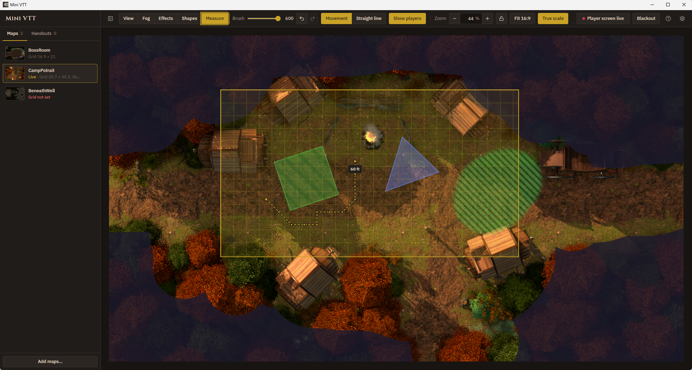
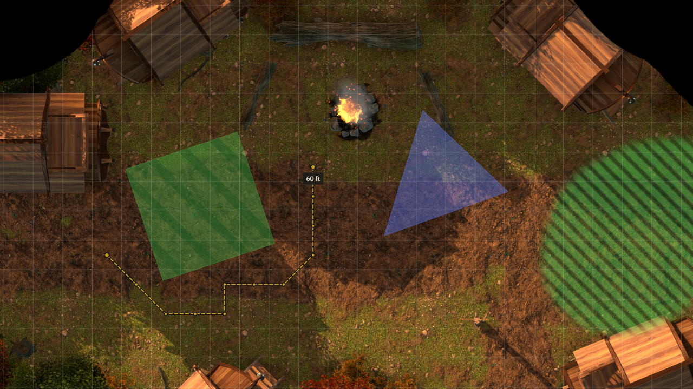

# Mini VTT

First of all I have used AI to build this project. But no AI art, music or other artistic assets are AI.
I am an senior engineer but i program VHDL mostly. So while I am quite experienced in designing robust firmware I lack the skills to make something like this within any reasonable time without AI.
Also this is based upon Lazy DM Companion I found on github with an license stating it was free to use. https://github.com/felipeabviana/lazy_dm_companion
If author is not ok with this i will remove if from public view.

So this is VTT I wanted to make because my group play local only with a weak laptop and a OLED TV laying flat connected by HDMI. No token. No online. Just maps and fog of war basically. Focus of the software is low system resource usage.

You run Mini VTT on your laptop. The **DM window** stays on your screen, where you pick maps, paint fog of war and decide what the players see. The **player screen** goes on a TV, a monitor laid flat on the table, or a projector, and shows only the part of the map you've framed, with unrevealed areas in solid black.

It's built to stay out of the way on modest hardware: no accounts, no server, no internet connection, and nothing running in the background while you're not touching it.

| DM window                                                                                                                                        | Player screen                                                                                                       |
| ------------------------------------------------------------------------------------------------------------------------------------------------ | ------------------------------------------------------------------------------------------------------------------- |
|  |  |

## Features

- **Fog of war.** Select the Fog tool and paint: the left mouse button reveals, the right button covers. Undo and redo any change, or reveal or cover the whole map at once. The DM sees fog as an indigo tint; players see solid black.
- **Painted effects.** The Effects tool paints fire, poison or magic onto the map with soft edges, for burning terrain, poison clouds or spell areas. Right-click erases, **Clear** removes them all. Effects sit under the fog, so they never give away unexplored areas, and poison is hatched so it stays distinct from fire for colour-blind players. A map that never uses effects costs nothing extra.
- **Player view framing.** A teal frame on the DM window shows exactly what the player screen shows. Drag it to pan and Ctrl+scroll to zoom.
- **True-scale grid.** Enter the player screen's diagonal and your grid size, and the frame shows a grid that matches the physical screen, so 1-inch minis line up with the map.
- **Blackout.** One key hides everything on the player screen while you set up the next scene.
- **Map library.** Maps, along with each map's fog, effects, zoom, framing, rotation and mirroring, are saved automatically and restored when you switch maps or restart.
- **Animated maps.** WebM videos work as maps alongside PNG, JPEG, GIF, WebP and BMP images.
- **Handouts.** Show a letter, portrait or clue fullscreen on the player screen, then hide it to return to the map.
- **Clean player screen.** Its few buttons and the mouse cursor fade out when the mouse is idle, so players only see the map.

## Getting started

### Download

Prebuilt Windows and macOS builds are published on the [Releases](https://github.com/Paertan85/mini_vtt/releases) page when available. The builds are not code-signed, so Windows SmartScreen and macOS Gatekeeper will warn the first time you open them.

### Build from source

You'll need [Node.js](https://nodejs.org/) 20 or newer.

```bash
git clone https://github.com/Paertan85/mini_vtt.git
cd mini_vtt
npm install
npm run dev
```

To package an installer:

```bash
npm run dist:win   # Windows installer + portable .exe, written to release/
npm run dist:mac   # macOS .dmg (arm64 and x64); run this on a Mac
```

## Running a session

1. Click **Add maps…** in the library, or drop image or WebM files onto it. New maps start fully fogged.
2. Click **Open player screen** and drag that window onto the table screen. Press F11, or use the button in its corner, to go fullscreen.
3. Optionally, open **Settings → Player screen setup…** and enter the screen's diagonal and your grid size to get a true-scale grid in the frame.
4. With the **Frame** tool, drag the teal frame to choose what the players see, and Ctrl+scroll to zoom.
5. Switch to the **Fog** tool and paint to reveal areas as the party explores.

Everything is saved as you go. Double-click another map in the library to switch; it comes back exactly as you left it. Rotation and mirroring are in each map's **⋯** menu.

### Controls

| Action                              | How                                                                                    |
| ----------------------------------- | -------------------------------------------------------------------------------------- |
| Frame / Fog / Effects tool          | V / F / E                                                                              |
| Reveal / cover fog                  | Fog tool, then drag with the Left Mouse button / Right mouse button                    |
| Paint / erase effects               | Effects tool, pick a colour, then drag with the Left Mouse button / Right mouse button |
| Paint fog with any tool             | Hold Shift and use either mouse button                                                 |
| Move the player view while painting | Hold Space and drag the frame                                                          |
| Brush size                          | Ctrl + mouse wheel with the Fog or Effects tool                                        |
| Undo / redo                         | Ctrl+Z / Ctrl+Y or Ctrl+Shift+Z (effects in the Effects tool, otherwise fog)           |
| Zoom the player view                | Ctrl + mouse wheel with the Frame tool, or the − and + buttons                         |
| Blackout the player screen          | B                                                                                      |
| Load a map / show a handout         | Double-click it in the library                                                         |
| Rename, rotate, mirror or remove    | The ⋯ menu on the map or handout                                                       |
| Handout zoom and pan                | Ctrl + wheel and arrow keys on the player screen (Shift for bigger steps); Esc closes  |
| Player screen fullscreen            | F11 or the corner button                                                               |

All shortcuts are also listed under **Settings → Keyboard shortcuts…**.

### Where your library is stored

Maps, fog masks and settings live in a `library` folder inside the app's user-data directory (typically `%APPDATA%\mini-vtt\library` on Windows and `~/Library/Application Support/mini-vtt/library` on macOS). **Settings → Open library folder** opens it. Imported files are copied there, so moving or deleting the originals doesn't affect the library.

### Moving your library to another computer

**Settings → Export project…** saves the whole library (every map and handout with its fog, effects, zoom, framing, rotation, mirroring and order, plus the player screen setup) as a single `.minivtt` file. Copy that file to the other computer and choose **Settings → Import project…** there. Importing adds the project's maps and handouts to whatever is already in the library and never replaces anything; the player screen setup is taken over only when the library is still empty.

## Development

```bash
npm run dev          # start the app with hot reload
npm run typecheck    # TypeScript, strict mode
npm run lint         # ESLint
npm run format       # Prettier
npm test             # library tests (runs inside Electron)
npm run test:app     # end-to-end test of the built app
```

On Linux without a display, run the tests under `xvfb-run -a`.

### Project layout

```
electron/
  main.ts        Main process: windows, IPC relays, fog saving, the map-media:// protocol
  preload.ts     The window.electronAPI bridge (its type is derived from here)
  library.ts     On-disk library: index.json, media, thumbnails, fog masks
src/
  App.tsx                      DM window: library, loaded map, player window, shortcuts
  hooks/useFog.ts              Fog mask, painting, undo/redo and sync
  components/MapStage.tsx      Map, fog canvas, player frame and brush
  components/Toolbar.tsx       Tools, zoom and player screen controls
  components/MapLibraryPanel.tsx
  components/PlayerScreen.tsx  The player window
  components/Dialogs.tsx       Player screen setup and keyboard shortcuts
  ui/                          Buttons, menus, dialogs, toasts and confirmations
  lib/                         Geometry and fog helpers shared by both windows
  types/                       Types shared by all processes
scripts/         Tests and the Windows icon patch used by electron-builder
```

Both windows load the same page; the player screen is opened with `?mode=view`. The DM window owns all state and pushes it to the player screen over IPC. Fog strokes are streamed as they're painted; at the end of each stroke the DM window encodes the mask once, and the main process relays that snapshot to the player screen and saves it to disk.

See [CONTRIBUTING.md](CONTRIBUTING.md) before opening a pull request. The design rules for keeping the app light on low-end laptops are in [AGENTS.md](AGENTS.md).

## Built with

[Electron](https://www.electronjs.org/), [React](https://react.dev/), [TypeScript](https://www.typescriptlang.org/), [Vite](https://vite.dev/) and [Tailwind CSS](https://tailwindcss.com/). Typefaces: [IBM Plex Sans](https://github.com/IBM/plex) and [Cinzel](https://github.com/NDISCOVER/Cinzel-Font) (both SIL Open Font License), bundled with the app.

## License

[MIT](LICENSE) © Paertan85
